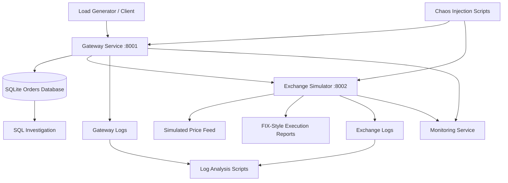

# TradeWatch — Order Flow Monitoring & Log Analysis

A simulated trading platform designed to practise **Application Support Engineering, Production Troubleshooting, Log Analysis, SQL, Monitoring, and Incident Management**.

TradeWatch simulates an order-processing system with a gateway service and an exchange simulator. It allows you to generate orders, trace requests across services, investigate failures, detect stale market data, reconcile uncertain order states, and document incidents through post-mortems.

The project focuses on a critical production-support principle: **when a financial transaction has an uncertain outcome, investigate and reconcile before retrying it.**

## Key Features

- **Order lifecycle simulation:** Process orders through states such as New, Acknowledged, Filled, Partially Filled, Rejected, and Pending.
- **Distributed request tracing:** Use a shared `req_id` to follow an order across the gateway and exchange services.
- **Structured logging:** Generate searchable, key-value logs for troubleshooting and incident investigation.
- **REST APIs:** Submit orders, retrieve order information, inspect metrics, and reconcile pending orders.
- **SQL-based investigation:** Query order records, identify stuck orders, and analyse rejection patterns.
- **Health monitoring:** Check service availability, exchange latency, feed freshness, and failure rates.
- **Chaos engineering:** Simulate stale feeds, slow exchanges, exchange outages, and rejection storms.
- **Incident response practice:** Investigate failures, restore service, verify recovery, and write post-mortems.
- **Optional auto-restart:** Restart unhealthy services with a cooldown to help prevent restart loops.

## Architecture



### Components

| Component       | Responsibility                                                                                        |
| --------------- | ----------------------------------------------------------------------------------------------------- |
| `gateway/`      | Receives orders, validates requests, communicates with the exchange, and maintains order records.     |
| `exchange_sim/` | Simulates exchange processing, execution reports, and futures price feeds.                            |
| `common/`       | Provides shared logging utilities and FIX-style message construction and parsing.                     |
| `monitor/`      | Checks service health, feed freshness, failures, and latency; supports optional auto-restart.         |
| `scripts/`      | Provides load generation, service management, chaos injection, log analysis, and SQL execution tools. |
| `sql/`          | Contains SQL queries for operational investigations.                                                  |
| `docs/`         | Contains operational runbooks and incident post-mortem templates.                                     |

## Technology Stack

- **Language:** Python
- **Backend:** FastAPI
- **ASGI Server:** Uvicorn
- **Database:** SQLite
- **Data Access:** SQL
- **Logging:** Structured key-value logs
- **Messaging Simulation:** FIX-style execution reports
- **Monitoring:** Custom Python health and alert monitor
- **Testing & Troubleshooting:** Load generation, chaos scripts, shell-based log analysis
- **Environment:** Linux, macOS, or WSL on Windows

## Getting Started

### Prerequisites

- Python 3.10 or later recommended
- `pip`
- Git
- Linux, macOS, or WSL on Windows
- Bash for the service-management and log-analysis scripts

### 1. Clone the repository

```bash
git clone <your-repository-url>
cd tradewatch
```

Replace `<your-repository-url>` with your GitHub repository URL.

### 2. Create a virtual environment

```bash
python3 -m venv .venv
source .venv/bin/activate
```

On Windows PowerShell, activate it using:

```powershell
.venv\Scripts\Activate.ps1
```

### 3. Install dependencies

```bash
pip install -r requirements.txt
```

### 4. Configure the Python path

Run this from the project root in each new terminal:

```bash
export PYTHONPATH=.
```

### 5. Start the services

On Linux, macOS, or WSL:

```bash
bash scripts/service.sh start all
bash scripts/service.sh status all
```

If the service-management script is unavailable, start the services in separate terminals:

**Terminal 1 — Exchange Simulator**

```bash
python -m uvicorn exchange_sim.main:app --port 8002
```

**Terminal 2 — Gateway**

```bash
python -m uvicorn gateway.main:app --port 8001
```

Ensure `PYTHONPATH=.` is configured in both terminals.

## Using TradeWatch

### Generate test orders

Generate 100 simulated orders:

```bash
python scripts/load_gen.py -n 100
```

### Inspect service metrics

```bash
curl http://localhost:8001/metrics
```

View recent order records:

```bash
curl "http://localhost:8001/orders?limit=5"
```

Inspect the simulated price feed and its freshness:

```bash
curl http://localhost:8002/prices
```

### Run a health check

```bash
python -m monitor.monitor --once
```

An exit code of `0` indicates that the monitor considers the system healthy.

### Explore the API

FastAPI's interactive API documentation is available at:

- Gateway: http://localhost:8001/docs
- Exchange Simulator: http://localhost:8002/docs

## Log Analysis

Log analysis is a core part of TradeWatch. Each event is recorded as a key-value log line, and a shared request ID helps correlate events across services.

### Built-in queries

Run the following commands from the project root:

```bash
# Find the most common errors
bash scripts/log_queries.sh top-errors

# Analyse errors per minute
bash scripts/log_queries.sh errors-per-minute

# Investigate rejected orders
bash scripts/log_queries.sh rejects

# Find the slowest requests
bash scripts/log_queries.sh slowest

# Trace a specific order across services
bash scripts/log_queries.sh trace <req_id>
```

Monitor gateway errors in real time:

```bash
tail -f logs/gateway.log | grep --line-buffered "level=ERROR"
```

### Suggested practice exercises

Write your own queries to investigate:

- Rejected orders grouped by symbol.
- Order volume per user per minute.
- Error rates before and after an incident.
- Requests with unusually high latency.
- Orders that remain pending beyond an expected threshold.
- Correlated gateway and exchange failures.

## SQL Investigations

TradeWatch uses SQLite to persist order information and support operational queries.

Run the included SQL query file:

```bash
python scripts/run_sql.py sql/queries.sql
```

Try implementing these investigations:

1. Find orders that have been pending for more than five minutes.
2. Calculate order counts by status.
3. Identify symbols with unusually high rejection rates.
4. Find orders created during a service outage.
5. Compare successful and failed order volumes over time.

These exercises help develop practical SQL skills for production support and incident investigation.

## Incident Drills & Chaos Engineering

TradeWatch includes scripts to inject controlled failures into the simulated environment.

**Recommended workflow:** Start the monitor, inject a failure, generate test traffic, inspect logs and SQL records, determine the impact, restore service, verify recovery, and document the incident.

| Scenario             | Failure injection                      | Investigation focus                            |
| -------------------- | -------------------------------------- | ---------------------------------------------- |
| Stale price feed     | `python scripts/chaos.py freeze-feed`  | Feed age, `FEED_STALE` alerts, exchange logs   |
| Slow exchange        | `python scripts/chaos.py latency 3000` | Timeouts, elevated latency, pending orders     |
| Exchange outage      | `python scripts/chaos.py down`         | `SEND_FAILED`, `EXCHANGE_DOWN`, gateway errors |
| Rejection storm      | `python scripts/chaos.py reject-all`   | Rejection spikes and exchange-side failures    |
| Invalid user request | Submit an order with symbol `XX`       | `order_invalid`, HTTP 400, input validation    |

Run the monitor in a separate terminal:

```bash
python -m monitor.monitor
```

For auto-restart experiments:

```bash
python -m monitor.monitor --auto-restart
```

Generate traffic while investigating a failure:

```bash
python scripts/load_gen.py -n 100
```

After each drill, restore the simulated environment:

```bash
python scripts/chaos.py reset
```

**Important:** Verify the actual service state and order records after recovery. A successful process restart alone does not establish that every order has reached the correct final state.

## Critical Support Concept: Unknown Order State

One of the most important scenarios simulated by TradeWatch is an exchange timeout.

A timeout does not necessarily mean the exchange failed to process an order. The exchange may have accepted or executed it even though the gateway did not receive the response.

A safe investigation process is:

1. Identify the affected order using its order ID or `req_id`.
2. Trace the request through gateway and exchange logs.
3. Inspect the persisted order state and available execution reports.
4. Reconcile the order with the exchange simulator.
5. Verify the resulting state before taking further action.

For example, a pending order can be reconciled using the gateway endpoint:

```bash
curl -X POST http://localhost:8001/orders/<id>/reconcile
```

Replace `<id>` with the actual order ID.

**Why this matters:** Blindly resending an order after a timeout can create duplicate orders. In real trading systems, safe recovery may require execution-report correlation, idempotency controls, and exchange-specific recovery procedures.

## Incident Documentation

For every incident drill, document the investigation using:

`docs/postmortem_template.md`

A useful post-mortem should cover:

- **Summary:** What happened?
- **Impact:** Which orders and services were affected?
- **Detection:** Which alert or symptom identified the incident?
- **Timeline:** When did the incident start, get detected, and get resolved?
- **Root cause:** What caused the failure?
- **Resolution:** What actions restored service?
- **Verification:** How was recovery confirmed?
- **Prevention:** What monitoring, testing, or engineering changes would reduce recurrence?

Keep your best two or three post-mortems in `docs/` as examples of your incident-management work.

## Project Structure

```text
tradewatch/
├── common/
│   ├── logsetup.py
│   └── fix.py
├── exchange_sim/
│   └── main.py
├── gateway/
│   └── main.py
├── monitor/
│   └── monitor.py
├── scripts/
│   ├── service.sh
│   ├── load_gen.py
│   ├── chaos.py
│   ├── log_queries.sh
│   └── run_sql.py
├── sql/
│   └── queries.sql
├── docs/
│   ├── postmortem_template.md
│   └── runbook.md
├── logs/
├── requirements.txt
└── README.md
```

## Skills Demonstrated

- Application and production support fundamentals.
- REST API troubleshooting with FastAPI.
- Cross-service request tracing and structured log analysis.
- SQL-based investigation and order-state analysis.
- Health checks, latency monitoring, and stale-feed detection.
- Incident triage, impact assessment, and service recovery.
- Safe handling of uncertain transaction outcomes.
- Controlled failure injection and recovery validation.
- Operational documentation and post-mortem writing.

## Limitations

TradeWatch is an educational simulation, not a production trading platform.

- Uses a simulated exchange rather than a real exchange connection.
- Uses SQLite rather than a production-grade transactional database.
- Uses FIX-style messages rather than a complete FIX engine.
- Does not implement full FIX sequence-number recovery or resend handling.
- Uses a simplified order lifecycle and simulated price feeds.
- Does not guarantee production-grade delivery, persistence, or reconciliation semantics.

Never connect this project to a live trading account or use it to execute real financial transactions.

## Future Improvements

Potential extensions include:

- [ ] Prometheus metrics and Grafana dashboards.
- [ ] Docker and Docker Compose support.
- [ ] Automated integration and fault-injection tests.
- [ ] More robust reconciliation and idempotency mechanisms.
- [ ] FIX session sequence-number and resend recovery.
- [ ] Persistent incident history and alert notifications.
- [ ] More advanced SQL reports and latency percentiles.
- [ ] Structured JSON logging and improved trace correlation.

## Learning Objective

TradeWatch is intended to provide hands-on practice with the types of investigations an Application Support Engineer may perform: understanding service dependencies, tracing transactions, distinguishing user errors from system failures, analysing production-style logs, using SQL to establish facts, and documenting incidents clearly.

**The goal is not just to make the services run, but to understand what happened when they do not.**

---

**Author:** [Kamalveer Singh](https://github.com/kamal-stark-dev)

**Project:** TradeWatch — Order Flow Monitoring & Log Analysis

**Disclaimer:** This project is for educational purposes only. All orders, market prices, and exchange responses are simulated.
